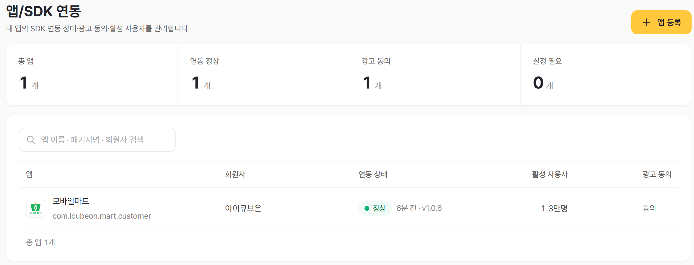

# 5. 연동 확인

출시 전에 테스트 기기로 연동 상태와 메시지 표시를 확인합니다.

## 시작하기 전에

* SDK를 넣은 테스트 빌드를 Android 기기에 설치합니다.
* Gradle 동기화, 매니페스트 병합, R8 빌드가 성공했는지 확인합니다.
* 관리자(popcon.biz)에 테스트 빌드의 패키지명으로 앱이 등록되어 있어야 합니다.

## 연동 확인하기

**1. 앱을 실행하고 동의합니다**

첫 실행 때 팝콘메시지 수신 동의 화면이 표시됩니다. 동의하면 알림 권한 창과 다른 앱 위에 표시 설정 화면이 차례로 열립니다.

**2. 관리자에서 연동 상태를 확인합니다**

**앱 관리 > 앱/SDK 연동**에서 앱의 연동 상태가 **정상**으로 표시되면 SDK가 서버에 연결된 것입니다. 마지막 신호 시각과 SDK 버전이 함께 표시됩니다.



**3. 테스트 메시지를 받습니다**

운영 담당자([popcon@popcon.biz](mailto:popcon@popcon.biz))에게 테스트 발송을 요청합니다. 요청할 때 앱 패키지명과 테스트 기기 모델을 함께 알려 주세요.

화면 위에 아이콘이 표시되면 수신에 성공한 것입니다.

**4. 표시와 결과를 확인합니다**

아이콘을 처음 누르면 앱이 실행되고 화면 위에 카드가 펼쳐집니다. 아이콘 오른쪽 위의 X를 누르면 그 메시지만 사라집니다. 관리자 메시지 이력에서 표시 결과를 확인합니다.

## 상황별 동작 확인하기

* 다른 앱 위에 표시 권한을 끄면 아이콘 대신 알림으로 도착합니다. 알림을 누르면 첫 번째 카드의 이미지 링크가 열립니다.
* 앱 설정에서 팝콘메시지를 끄면 이후 메시지가 표시되지 않습니다.
* 아이콘을 눌러 카드를 펼친 뒤 다시 최소화하고 또 누르면, 앱은 다시 실행되지 않고 카드만 펼쳐집니다.
* 기존 앱 푸시는 이전과 같이 알림 표시줄에 도착합니다.

## 로그로 확인하기

관리자 화면으로 확인하기 어려우면 Logcat으로 확인합니다.

```kotlin
val popcon = AutoPopupManager.getInstance(applicationContext)
Log.d("PopconSDK", "registered=${popcon.isTokenSendedServer()}")  // "true"면 서버 등록 요청 완료
```

* SDK 초기화에 성공하면 `onCompleteListener()`가 호출됩니다.
* 팝콘메시지를 받으면 `autoPopupFCMHandler()`가 `true`를 돌려줍니다.
* 토큰이 바뀌면 `onNewToken()`에서 SDK 재등록이 성공합니다.

> [!NOTE]
> SDK 로그는 `[AUTOPOPUP_SDK]`로 시작합니다. Logcat 검색창에 `AUTOPOPUP_SDK`를 입력하면 SDK 로그를 모아 볼 수 있고, 서버 통신 로그는 `AutoPopupRepository` 태그로 따로 남습니다. 로그 출력을 켜고 끄는 설정은 없습니다.

## 연동 상태 기준

* **정상**: 최근 24시간 안에 SDK 신호가 있습니다.
* **확인 필요**: 24시간 넘게 신호가 없습니다.
* **끊김**: 7일 넘게 신호가 없습니다. 회원사에 알림이 갑니다.

신호가 다시 오면 자동으로 정상으로 바뀝니다.

## 출시 전 확인

* 운영 빌드의 패키지명이 관리자에 등록되어 있는지
* 수신 동의 화면과 권한 요청이 순서대로 나오는지
* 개인정보 처리방침과 Play 데이터 보안 양식을 고쳤는지 → [6. 개인정보 처리방침과 Play 데이터 보안](privacy-and-play.md)
* 테스트용 로그 코드를 뺐는지
