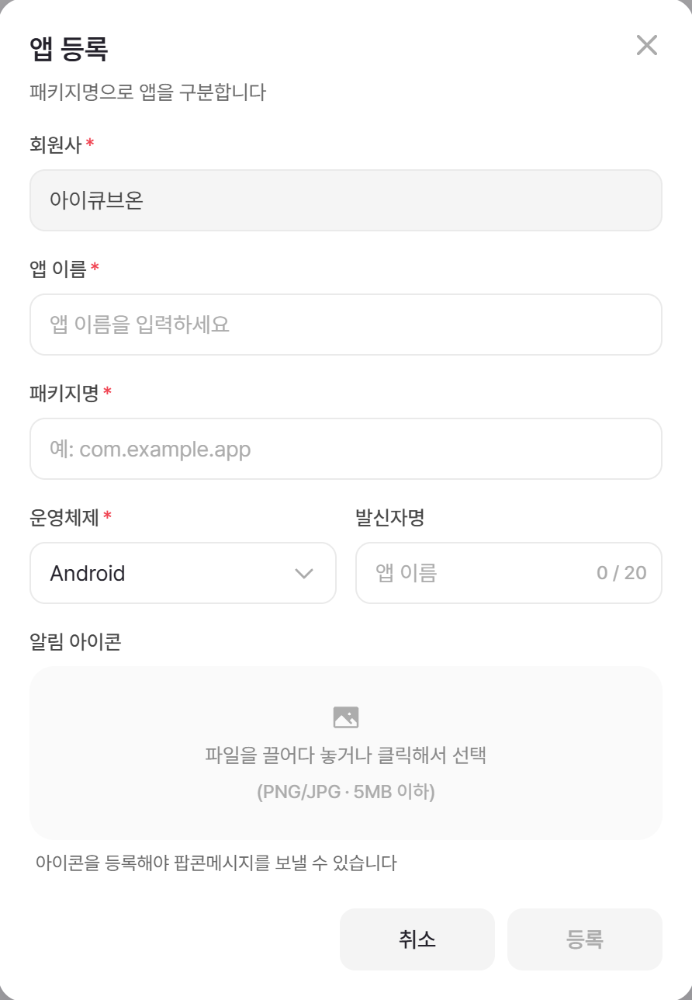

# 1. 연동 준비

SDK를 설치하기 전에 관리자에 앱을 등록하고 개발 환경을 확인합니다.

## 관리자에 앱 등록

popcon.biz의 **앱 관리 > 앱/SDK 연동**에서 **앱 등록**을 누르고 앱 이름, 패키지명, 발신자명, 알림 아이콘을 입력합니다.

* SDK는 등록한 **패키지명**으로 앱을 구분합니다. 별도 SDK 키는 없습니다.
* 알림 아이콘을 등록해야 팝콘메시지를 보낼 수 있습니다.

> [!WARNING]
> 패키지명은 등록한 뒤 바꿀 수 없습니다. SDK는 설치된 빌드의 실제 패키지명을 서버에 보내므로, 테스트 빌드의 패키지명이 다르면(예: `.dev`가 붙은 빌드) 그 패키지명으로도 앱을 등록합니다.

## 지원 환경

* 최소 지원 버전: Android 5.0(API 21) 이상
* compileSdk: 35 권장
* AndroidX를 쓰는 프로젝트
* Firebase Cloud Messaging 적용(`google-services.json`)
* 필요한 권한: 알림, 다른 앱 위에 표시, 광고 ID

> [!NOTE]
> 아동을 주 대상으로 하는 앱은 연동할 수 없습니다.

## 연동 순서

1. [SDK 설치와 초기화](../integrate/install-and-init.md): 의존성을 추가하고 SDK를 켭니다.
2. [팝콘메시지 수신 설정](../integrate/README.md): 수신 동의와 권한을 받고, FCM 수신 서비스에 SDK를 연결합니다.
3. [연동 확인](../before-release/verification.md): 테스트 기기에서 연동 상태와 메시지 표시를 확인합니다.
4. [개인정보 처리방침과 Play 데이터 보안](../before-release/privacy-and-play.md): 출시 전에 처리방침과 데이터 보안 양식을 고칩니다.

관리자 앱 목록의 연동 상태가 **정상**으로 바뀌면 SDK가 서버와 연결된 것입니다.
